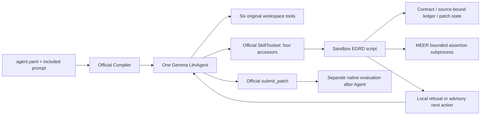

# Actual architecture and EGRD execution boundary

Audit base: PR44 commit0d4c335e3517cd25d8e0a3d818cb51fb38ee0989. Branch egrd-v01-12b is isolated from it. Direct Git HTTPS fetch failed twice; the authenticated GitHub connector creates/commits the isolated remote branch. Existing D: worktrees are read-only audit inputs, not silently checked out or reset.

| Component | Actual implementation | Classification |
|---|---|---|
| S0 | one YAML LlmAgent, six named workspace tools, system prompt, 300s/60calls/120s-command research config | Executable SDK budget; prompt workflow advisory |
| FullV0.1 | same six-tool agent, expanded hypothesis/EGV instructions, explicit generation config | Prompt-only repair policy; no state controller |
| EGRV0.4 | appended evidence-guided repair block; original YAML/tool interface | Prompt-only causal/evidence workflow |
| R2 | six deadline rules appended to a later nine-tool Baseline; graph tools already in that baseline and discouraged by prompt | Prompt-only; not same artifact as S0 |
| Prior EGRD v01 | autopsy, design and implementation GO gates | Planned, no deployed global controller |
| MEER | one executable official Skill; actual assertion subprocess, source/check hashes, duplicate suppression, timeout/child cleanup | Deterministic within optional Skill; bypass possible |
| Context Guard | research host LiteLLM client interceptor with exact /tokenize, input+output reservation and Issue restoration | Executable host research control; absent from official ZIP/compiler callback registry |
| R12/paired runner | supervisor, coordinator, HTTP observer, independent verifier and non-root chroot/UID cleanup | Host orchestration/observation/evaluation, not deployed Agent intelligence |
| Latest CPU hardening | source CLI/locale preflight and live tool-error stop latch | Executable host infrastructure control; no change to frozen Agent |

The organizer compiles YAML against closed ToolRegistry/ModelRegistry. In the pinned run_agent_sandbox path, it provides AdkSandboxCodeExecutor but no competitor CallbackRegistry. The real compiler probe confirms that merely naming a before_tool callback without that registry does not activate it. No custom Agent Python entrypoint, middleware, tool wrapper or replacement official submit tool is smuggled into the submission.

Deployed path: one Gemma LlmAgent → six original workspace tools + organizer SkillToolset → sandbox execution of a single bundled EGRD script → bounded state/evidence/decision result → the same Gemma chooses its next official action. There is no second Agent, planner model or extra inference just to choose the next action. SDK compaction, if used by the host, is separate inherited context management and its requests must still be counted.

The inspected SkillToolset actually exposes **four** accessors: list_skills, load_skill, load_skill_resource, run_skill_script. Thus the matched candidate interface has ten accessible tools, six original plus four official accessors; it is not described as exactly six tools. No arbitrary custom tool is registered. This interface addition is held identical in A/B/C/D and differs from frozen S0.

Core.py implements the local state/ledger, quoted Issue requirements, hypothesis links, Patch Intent, stale evidence, bounded check/rollback/revision/acceptance and budget observations. Next-action recommendations and semantic linkage are ADVISORY. The script can refuse its own invalid acceptance/check operations, but cannot block direct edit_file, run_command or submit_patch bypass. Issue alignment is structurally traced, not semantically proven.

The copied MEER verifier is hash-pinned and unchanged. Build combines its definitions, core and CLI into one self-contained Skill script because the official executor materializes a script, not an arbitrary competitor host package. Research Worker/Coordinator files are outside submission ZIPs.

The arrow from J back to Gemma is information, not compulsory tool interception. Native evaluation is performed afterward and cannot leak a hidden answer into the repair session.
